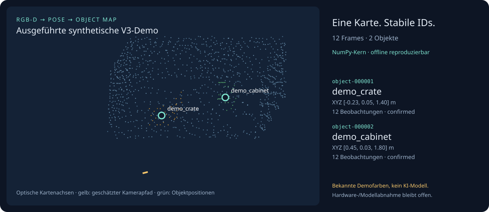
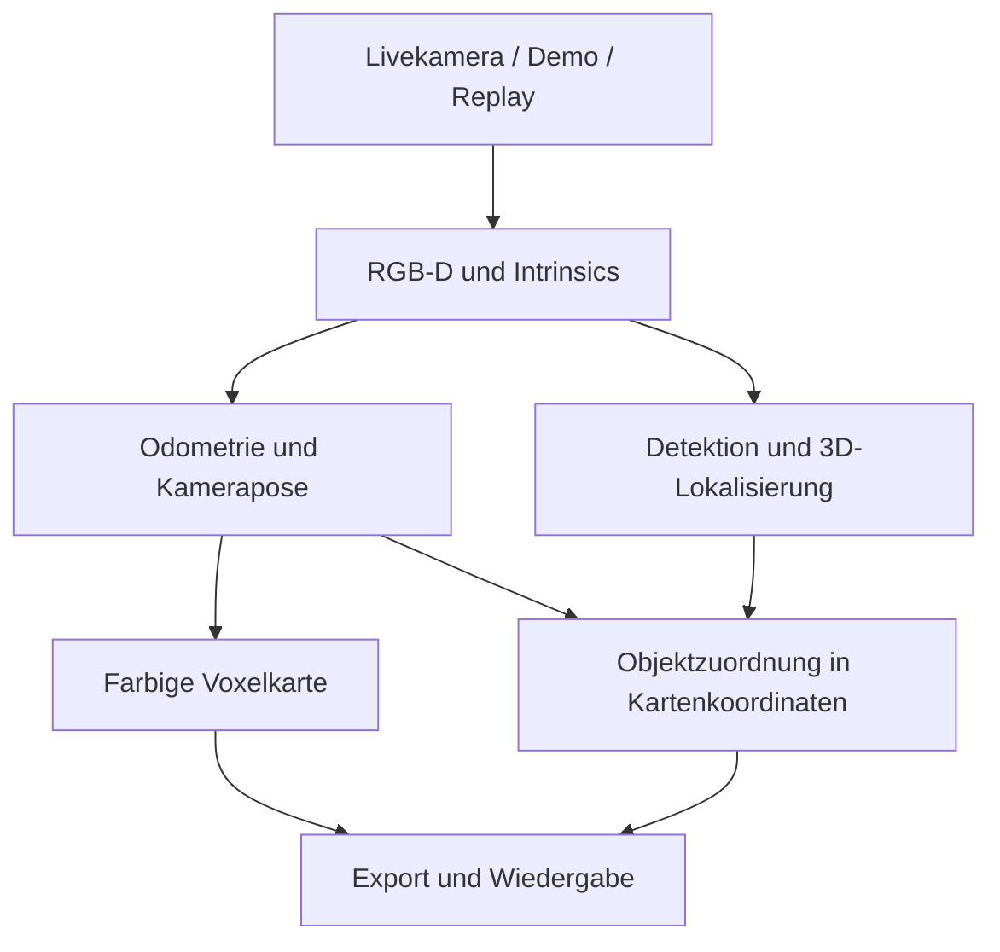

<div align="center">

# RealSense D435i Lab

**Von RGB-D-Aufnahmen zu vermessbaren Szenen und semantischen Objektkarten.**

[](https://github.com/CagriCatik/RealSense-D435i-Lab/actions/workflows/ci.yml)
[](pyproject.toml)
[](pyproject.toml)
[](LICENSE)
[](ros2/README.md)
[](docs/hardware-validation.md)

[**Schnellstart**](#schnellstart) · [**V3-Objektkarte**](#v3-semantische-objektkarte) · [**Tutorials**](TUTORIAL_INDEX.md) · [**Dokumentation**](#dokumentation)

</div>



Ein Python-Labor für die **Intel RealSense D435i**: RGB, Tiefe, IR und IMU untersuchen, räumliche Messungen entwickeln und die Ergebnisse bis zu einer lokalen Objektkarte zusammenführen. Die gleiche Verarbeitung arbeitet mit Livekamera, synthetischen Szenen und gespeicherten Aufnahmen.

Die Abbildung stammt aus der ausgeführten Demo-Pipeline. Ihre Klassen werden anhand bekannter synthetischer Farben erzeugt. **Reale Objekterkennung verwendet ein separat bereitgestelltes YOLO-Modell.**

## Was bereits funktioniert

| Anwendung | Ergebnis | Prüfstand |
|---|---|---|
| **V1 · Stationärer Szeneninspektor** | Referenzfläche, Objektcluster, Positionen, sichtbare Maße, Aufnahmevergleich | Synthetischer Kern und UI-Grenzen geprüft |
| **V2 · Mobile lokale Kartierung** | Tiefenodometrie, Kameratrajektorie, farbige Voxelkarte und Trackingverlust-Status | Bewegung gegen bekannte Sollposen und Replay geprüft |
| **V3 · Semantische Objektkarte** | Klassenbezogene Weltpositionen, wiederholte Beobachtungen, Objekt-IDs, Abfrage und Export | Synthetische Fusion und Detektions-Replay geprüft; reales Modell offen |
| **Sensorlabor** | Diagnose, RGB-D-/IR-Viewer, IMU, Filter, Punktwolken und Benchmarks | Kern geprüft; Geräteabnahme offen |
| **ROS 2 / RTAB-Map / TSDF** | Launch-Einstiege und Rekonstruktion mit vorgegebenen Posen | Syntax/Adapter vorhanden; Integrationsabnahme offen |
| **V4 · Robotikwahrnehmung** | Belegung, Sensorfusion und Navigationsanbindung | Geplant |

Die CI prüft den NumPy-Kern unter **Python 3.11–3.13**. Physische D435i, echte Desktopbedienung, GPU-/Modellinferenz, ROS und Open3D benötigen ihre eigene [Abnahme](docs/hardware-validation.md). Die vollständige [Funktionsmatrix](docs/capabilities.md) trennt Implementierung, Softwaretests und Hardware-Nachweise.

## Schnellstart

Python >=3.11. Referenzziel für Kamera/Robotik: Ubuntu 24.04 mit Python 3.12 und optional ROS 2 Jazzy.

```bash
git clone https://github.com/CagriCatik/RealSense-D435i-Lab.git
cd RealSense-D435i-Lab
python3 -m venv .venv
source .venv/bin/activate
python -m pip install -e .

# V3 vollständig ohne Kamera, GPU oder Modell ausprobieren
rs-lab map --source demo --semantic --frames 12 --output recordings/semantic-001
rs-lab objects --input recordings/semantic-001/semantic_map.json --confirmed
```

Du erhältst eine lokale Punktkarte und **zwei synthetische Objektlandmarken**, deren Beobachtungen über zwölf Ansichten zusammengeführt werden. Ausgabeverzeichnisse werden neu angelegt; für einen zweiten Lauf einen neuen Namen wählen. Windows- und SDK-Einrichtung: [setup.md](docs/setup.md).

Optional mit grafischer Vorschau:

```bash
python -m pip install -e '.[viewer]'
rs-lab map --source demo --semantic --frames 30 --output recordings/semantic-preview-001 --preview
```

## V3: Semantische Objektkarte

**Eine Detektion wird erst mit gültiger Tiefe und akzeptierter Kamerapose zu einer Kartenbeobachtung.** V3 lokalisiert sichtbare Objektpunkte innerhalb eines Maskenpolygons oder einer verkleinerten Bounding Box, überträgt sie in Kartenkoordinaten und ordnet sie anhand von Klasse und räumlichem Abstand bestehenden Objekten zu.

- Stabile **Objekt-IDs innerhalb einer Sitzung**, mit Status `tentative` / `confirmed`.
- Eine Zuordnung je Objekt und Bild; doppelte Boxen, fehlende Tiefe und ausgeschlossene Klassen werden protokolliert.
- Nachvollziehbare Beobachtungen mit Quelldatei, Zeitidentität, Detektionsindex, Kamerapose und Tiefenstreuung.
- Detektionsjournal mit RGB-D-Fingerabdruck: dieselbe Verarbeitung später ohne Modell erneut ausführen.
- Abfrage nach Klasse, Bestätigungsstatus und Mindestzahl von Beobachtungen.

### Mit D435i und lokalem YOLO-Modell

Zuerst Kamera im offiziellen RealSense Viewer prüfen und diesen danach schließen.

```bash
python -m pip install -e '.[camera,viewer,yolo]'
rs-lab inspect --output artifacts/device-001.json
rs-lab map --source camera --semantic --weights /pfad/zu/modell.pt --frames 300 --output recordings/semantic-real-001 --preview
```

Das Modell muss lokal vorhanden sein; das Lab lädt keine Gewichte automatisch herunter. Detektionsmodelle liefern Boxen, Segmentierungsmodelle zusätzlich Polygone in Originalbildkoordinaten. Die tatsächlich unterstützten Klassen hängen vom Modell ab.

### Ohne Kamera oder Modell wiedergeben

```bash
rs-lab map --source replay --input recordings/semantic-001 --semantic --frames 12 --output recordings/semantic-replay-001
rs-lab objects --input recordings/semantic-replay-001/semantic_map.json --label demo_crate --confirmed
```

Bei Replay wird das passende `detections.jsonl` automatisch gefunden. Für ein explizites Journal gibt es `--detections`. Änderungen an Bildinhalt oder Geometrie führen zu einem Fehler statt zu einer stillen Wiederverwendung alter Detektionen.

### Welche Dateien entstehen?

| Datei | Inhalt |
|---|---|
| `map.ply` | Farbige lokale Voxelkarte |
| `trajectory.json` / `tracking.jsonl` | Kameraposen, Trackingzustände und Qualitätskennzahlen |
| `semantic_map.json` | Objekt-IDs, Klassen, Positionen, sichtbare Ausdehnungen und Beobachtungshistorie |
| `objects.csv` / `objects.ply` | Kompakte Objekttabelle / Objektpositionspunkte |
| `detections.jsonl` / `observations.jsonl` | Rohdetektionen und zugeordnete bzw. abgelehnte Kartenbeobachtungen |
| `frame_*.npz` / `manifest.json` | RGB-D-Snapshots und akzeptierte Posen für Replay/TSDF |

Konfiguration, Format und Grenzen: [V3-Anleitung](docs/semantic-mapping.md).

## V1, V2 und Sensorlabor

```bash
# Szene stationär untersuchen und sichtbare Objektmaße anzeigen
rs-lab view --scene --source demo

# Kamera bewegen, lokale Geometrie ohne Detektor kartieren
rs-lab map --source camera --frames 300 --output recordings/map-real-001 --preview

# RGB-D, Infrarot und IMU separat untersuchen
rs-lab view --source camera
rs-lab infrared
rs-lab imu --seconds 10 --output recordings/imu-001.csv
rs-lab imu-report --input recordings/imu-001.csv
```

Explorer: **Leertaste** friert ein Bild ein; zwei Klicks im linken RGB-Bild messen den 3D-Abstand. `S` speichert, `P` exportiert eine Punktwolke, `M` die Zweipunktmessung, `Q` beendet. Im Szenenmodus setzt `C` die Referenz zurück. Die Karten-Vorschau ist eine X/Z-Projektion.

## Architektur



Der Kern benötigt **NumPy**. SDK, OpenCV, YOLO, Open3D und ROS bleiben an eigenen Grenzen. CLI, Livebetrieb und Replay verwenden dieselben Algorithmen. [Modulverantwortung und Datenverträge](docs/architecture.md)

## Einheiten und praktische Grenzen

Längen sind Meter; Tiefenwerte sind axiale Z-Werte. Die optischen Achsen zeigen x rechts, y unten, z vorwärts. Die lokale Karte beginnt im Koordinatensystem der ersten Kamera. Fehlende Tiefe bleibt unbekannt.

Der NumPy-Mapper verwendet lokale Tiefenodometrie mit Drift, ohne Loop Closure oder IMU-Fusion. V3 setzt statische Objekte voraus; Klasse und räumliche Nähe sind eine heuristische Zuordnung. `confirmed` bedeutet wiederholt beobachtet, keine bewiesene Identität. `person` ist standardmäßig ausgeschlossen. Verdeckungen, Hintergrund in Boxen, falsche Klassen und Kameradrift können Objektpositionen oder Zuordnungen verfälschen.

Sichtbare Ausdehnung ist kein vollständiges Körpermaß; MAD und Positionsstreuung sind keine kalibrierte Messunsicherheit. Nach erkanntem Trackingverlust wird die räumliche und semantische Fusion gestoppt. Teilkarten und Diagnosen bleiben erhalten. Hardwaregrenzen und maximale Profile stehen in der [Spezifikationsübersicht](docs/specification.md).

## Dokumentation

| Einstieg | Inhalt |
|---|---|
| [Einrichtung](docs/setup.md) | Python, SDK, Betriebssysteme und Fehlersuche |
| [16 Lernprojekte](TUTORIAL_INDEX.md) | Vom Sensorzugriff zur Robotik |
| [V1 · Szeneninspektor](docs/scene-inspector.md) | Referenzfläche, Segmentierung und Messung |
| [V2 · Mobile Kartierung](docs/mobile-mapping.md) | Odometrie, Karte, Trackingverlust und RTAB-Map |
| [V3 · Objektkarte](docs/semantic-mapping.md) | Lokalisation, Zuordnung, Detektions-Replay und Export |
| [CLI](docs/cli.md) | Befehle und Dateiformate |
| [Funktionsmatrix](docs/capabilities.md) | Implementiert / geprüft / noch offen |
| [Hardware-Abnahme](docs/hardware-validation.md) | Reproduzierbare physische Versuche |
| [Roadmap](docs/roadmap.md) | Offene Funktionen und V4 |
| [Offizielle Quellen](docs/sources.md) | Hersteller, SDK und Integrationen |

## Entwicklung

```bash
python -m unittest discover -s tests -v
python -m compileall -q src tests ros2
# README-Abbildung aus der synthetischen Pipeline neu erzeugen
python scripts/render_readme_demo.py
```

Tests schützen Geometrie, Fehlerzustände, Ressourcenfreigabe, Aufnahmeformate, Poseverkettung und Objektzuordnung. Aufnahmen, Modelle und erzeugte Sitzungsdaten bleiben außerhalb von Git. Änderungen sollten Funktionsmatrix und relevante Anleitung mitführen; die Architekturregeln stehen in [AGENTS.md](AGENTS.md).

**Autor:** Çağrı Çatık · **Lizenz:** [MIT](LICENSE). Abhängigkeiten und Modellgewichte behalten ihre jeweiligen Lizenzen.
